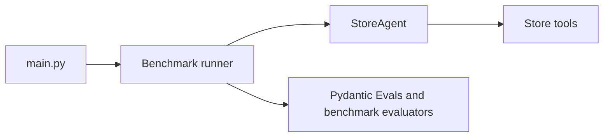

# Architecture

`main.py` is the application entry point. It validates the JSON configuration selected by `--config` (default `config/runner.json`) and calls `run_benchmark()`. The configuration selects scenario files, tested models, the shared judge model, the number of repetitions, and the results directory. [Entry point](../main.py) · [Runner configuration schema](schemas/runner-config.md)

The runner depends on `StoreAgent` and supplies a model, a store directory, and any session defined by the scenario. `StoreAgent` can operate independently with those dependencies. [Runner](../src/benchmark/runner.py) · [StoreAgent](../src/store_agent/store_agent.py)

## Benchmark execution

1. The runner loads the selected scenarios, validates them, and checks that their IDs are unique before creating the models. [Scenario schema](schemas/scenario.md)
2. For each tested model, Pydantic Evals runs every scenario the configured number of times, sequentially. For each execution, called a trial, the runner copies the store documents into a temporary directory and initializes a fresh SQLite database from the fixture. [Store database schema and fixture](schemas/store-database.md)
3. The runner takes an initial store snapshot, creates a fresh `StoreAgent`, and sends the scenario's prompts in order, including any attachments. All turns in a trial share the conversation history and store state. The runner records replies, tool calls, and tool returns, takes a final snapshot, and removes the temporary store when the trial ends. [Scenario output schema](schemas/scenario-output.md)
4. Pydantic Evals evaluates the collected evidence for completed trials. The runner writes one JSON report per tested model to `<results_dir>/<run-id>/<model-id>.json`, including execution failures and pending human reviews for completed trials. [Result schema](schemas/result.md)

## Evaluators

The two LLM judges share the configured `judge_model`. The deterministic evaluator applies the scenario's checks directly to the recorded evidence.

| Evaluator | Evidence and criterion |
| --- | --- |
| `ResponseJudge` | Assesses the agent's replies against `response_criterion`, when present. |
| `ToolJudge` | Assesses recorded tool calls, tool returns, and store snapshots against `tool_criterion`, when present. |
| `ToolExpectationsEvaluator` | Checks `tool_expectations` for specified tool calls, returned data, or persistent database changes between snapshots. |

The report records each evaluator's findings independently. [Automatic evaluations](schemas/result.md#automatic-evaluations) · [Tool expectations](schemas/scenario.md#tool-expectations)

## StoreAgent tools

`StoreAgent` registers seven tools for the supplied store directory. The agent's instructions define the rules for using them in each session. [Tool implementations](../src/store_agent/tools.py)

| Tool | Operation |
| --- | --- |
| `list_documents` | List available store Markdown documents. |
| `read_document` | Read the full text of a store document. |
| `create_order` | Create an order with its line items. |
| `get_order_details` | Read an order's delivery address and line items. |
| `update_delivery_address` | Change the delivery address on an order. |
| `delete_order` | Remove an order and its line items. |
| `update_product_price` | Change a product's catalog price. |
