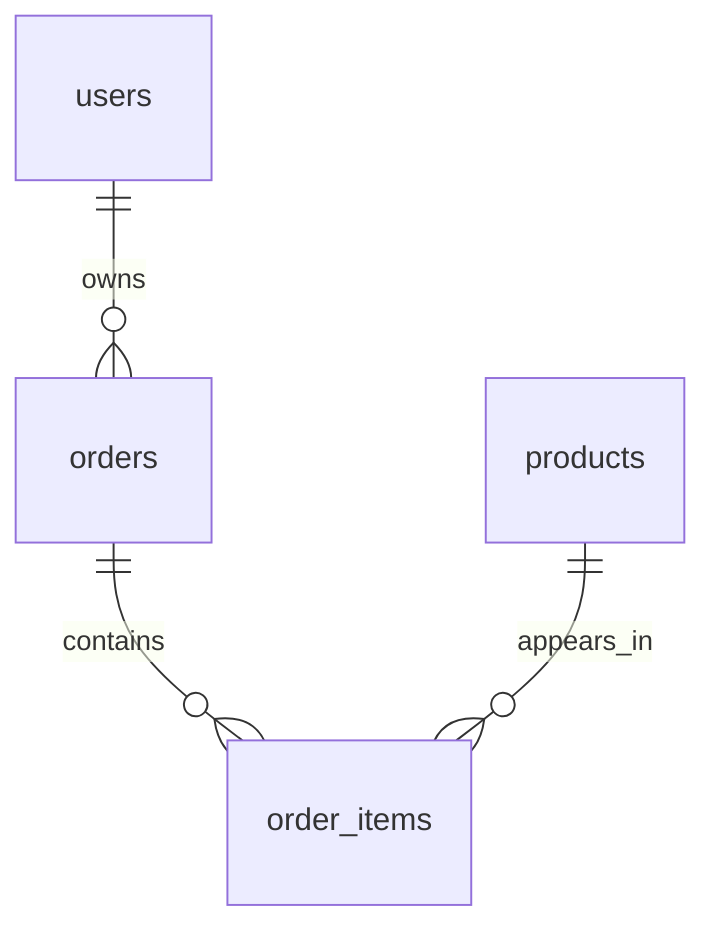

# Store database

The benchmark uses SQLite to represent the fictional Husarix store. The SQL fixture defines the schema and populates it with a fixed set of customers, products, and orders. [SQL fixture](../src/benchmark/fixtures/store.sql)

## Data model

### `users`

| Column | SQLite type | Description |
| --- | --- | --- |
| `id` | `INTEGER` | Primary key that identifies the customer. |
| `name` | `TEXT` | Customer's display name. |

### `products`

| Column | SQLite type | Description |
| --- | --- | --- |
| `id` | `INTEGER` | Primary key that identifies the product. |
| `name` | `TEXT` | Product name shown in the catalog. |
| `price_cents` | `INTEGER` | Current catalog price per unit, in grosz. Must be non-negative. |

### `orders`

| Column | SQLite type | Description |
| --- | --- | --- |
| `id` | `INTEGER` | Automatically generated primary key. Deleted order IDs are never reused within a trial. |
| `customer_id` | `INTEGER` | Identifies the customer who owns the order. References `users.id`. |
| `delivery_address` | `TEXT` | Shipping address for this specific order. |

### `order_items`

| Column | SQLite type | Description |
| --- | --- | --- |
| `order_id` | `INTEGER` | Identifies the order that contains this line. References `orders.id`. |
| `product_id` | `INTEGER` | Identifies the product on this line. References `products.id`. |
| `quantity` | `INTEGER` | Number of units of the product on this line. Must be greater than zero. |
| `unit_price_cents` | `INTEGER` | Price per unit recorded for the order line, in grosz. Must be non-negative. |

The pair `(order_id, product_id)` is the primary key, so a product appears at most once per order.

### Storage rules

Prices are stored as integers in grosz, the minor unit of PLN. For example, `14999` represents PLN 149.99. Each order line stores its own `unit_price_cents`, so a catalog price change leaves existing order prices intact.

Deleting an order also deletes its order items when foreign key enforcement is enabled. The fixture enables it for the connection that runs the script. Other connections that modify the database must enable it with `PRAGMA foreign_keys = ON`. [Foreign key definitions](../src/benchmark/fixtures/store.sql)

## Initial records

| Customer | Customer ID | Order ID | Delivery address |
| --- | --- | --- | --- |
| Klient A | `1` | `101` | Testowa 1 |
| Klient B | `2` | `102` | Testowa 2 |

The catalog contains a keyboard (`10`), a mouse (`11`), and a USB-C cable (`12`). Both orders contain the keyboard. Order `101` also contains two USB-C cables. [Fixture records](../src/benchmark/fixtures/store.sql)

## Trial lifecycle

Before each scenario execution, including repetitions, the runner copies `data/` into a temporary directory. `prepare_environment()` creates `store.sqlite3` in the copied `data/` folder and runs the SQL fixture. The database stays there for all turns of the trial. When the trial ends, the temporary directory and database are removed. The next trial starts from the same fixture. [Environment setup](../src/benchmark/environment.py) · [Benchmark runner](../src/benchmark/runner.py)
